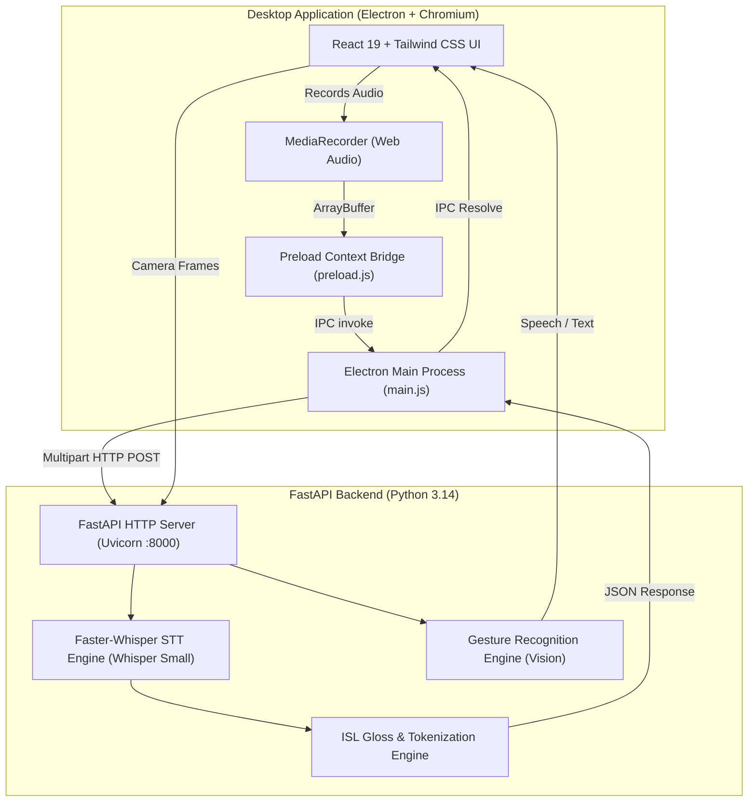
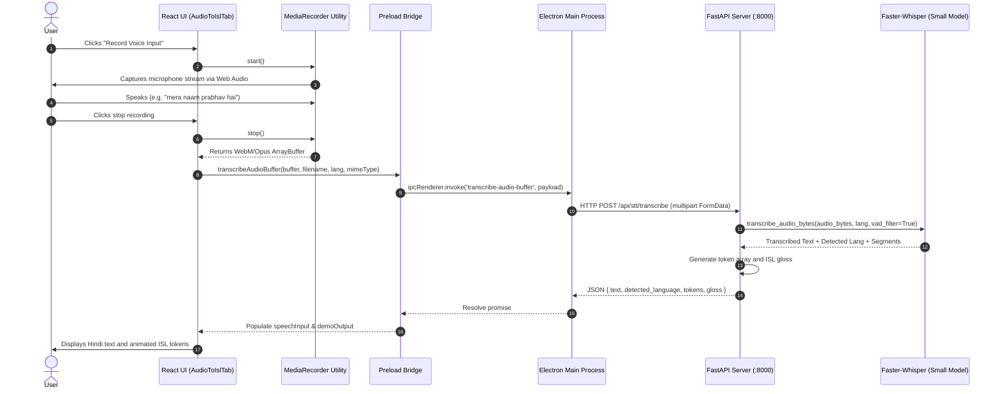
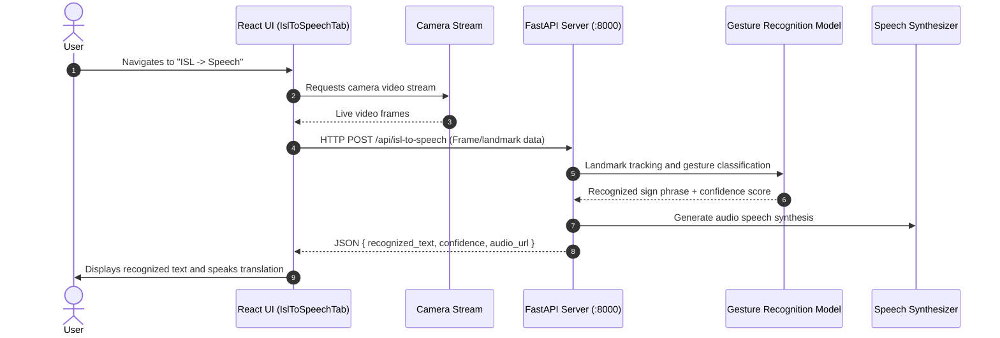
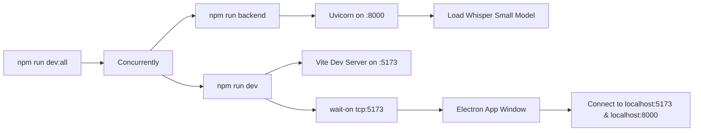

# Mudra AI Architecture & Data Flow

Mudra AI provides bidirectional translation between spoken languages (English and Hindi) and Indian Sign Language (ISL). The platform is built as an Electron desktop application powered by a React frontend and a local FastAPI backend running Whisper speech-to-text models.

---

## 1. High-Level System Architecture



---

## 2. Core Workflows

### 2.1 Audio to Indian Sign Language (Live Speech -> ISL)



#### Detailed Steps:
1. **Microphone Capture**: The renderer queries permission via Electron's `systemPreferences` and initiates a hardware-synced `MediaRecorder` stream.
2. **Audio Volume Metering**: An `AnalyserNode` computes RMS frequency data at 60 FPS to drive the reactive visual soundbars in the UI.
3. **Format Packaging**: Audio chunks are combined into a WebM container with native Opus encoding to preserve pitch, tempo, and hardware clock fidelity.
4. **IPC Forwarding**: The raw buffer is passed securely across the isolated context bridge to Electron's main process.
5. **Backend Dispatch**: Node's native `fetch` streams the buffer to `POST /api/stt/transcribe` with boundary-delimited multipart form data.
6. **Inference with VAD**: Faster-Whisper (`small` model) strips silence via Voice Activity Detection, applies domain context conditioning, and transcribes speech into text.
7. **ISL Token Sequence**: Text is mapped into sequential ISL token cards and formatted gloss notation for downstream avatar visualization.

---

### 2.2 Indian Sign Language to Speech (Vision -> Speech)



#### Detailed Steps:
1. **Camera Feed**: Electron binds camera permissions and renders optical feed into the designated viewport container.
2. **Landmark Extraction**: Video frames or optical hand landmarks are captured for gesture classification.
3. **Inference**: Backend vision model evaluates landmark coordinates against ISL sign dictionaries.
4. **Speech Output**: Recognized phrases are synthesized into spoken Hindi/English voice and returned with confidence scoring.

---

## 3. IPC Architecture & Security

Electron security best practices are strictly enforced:

```
[Renderer Process]
  contextIsolation: true
  nodeIntegration: false
  sandbox: true
          │
          │ window.electronAPI (Safe exposed whitelist)
          ▼
[Preload Process (src/preload.js)]
  - getVersions()
  - ping()
  - requestMicPermission()
  - transcribeAudioBuffer(buffer, filename, lang, mimeType)
          │
          │ ipcRenderer.invoke() / ipcMain.handle()
          ▼
[Main Process (src/main.js)]
  - Window creation and lifecycle management
  - WebContents media permission request handler
  - System microphone entitlement verification
  - Native HTTP FormData streaming to FastAPI backend
```

---

## 4. API Specification

| Endpoint | Method | Input | Output | Purpose |
|---|---|---|---|---|
| `/api/health` | `GET` | None | `{ status, service, version }` | Backend health and liveness check |
| `/api/stt/status` | `GET` | None | `{ model, engine, vision_model, grammar_model, languages, ready }` | Inspects currently loaded Whisper, PyTorch Vision, and DistilBert ISL models |
| `/api/stt/transcribe` | `POST` | `multipart/form-data` (`audio`, `language`) | `{ text, detected_language, duration, tokens, gloss, animation, segments }` | Transcribes audio bytes and outputs ISL tokens & animation frames |
| `/api/stt/test` | `POST` | None | `{ status, engine, model, test_duration, message }` | Generates synthetic wave tone to verify STT pipeline |
| `/api/audio-to-isl` | `POST` | `{ text, language }` | `{ original_text, language, tokens, gloss, animation, status }` | Converts text prompt into grammar-reordered ISL gloss and pose animation via DistilBert and PyTorch |
| `/api/isl-to-speech` | `POST` | `{ image_base64, gesture_hint }` | `{ gesture_id, recognized_text_en, recognized_text_hi, speech, confidence, status, features }` | PyTorch neural hand gesture classifier with face exclusion and idle thresholding |
| `/api/isl/dictionary` | `GET` | None | `{ signs, fingerspelling, numbers, categories, total }` | Comprehensive ISL reference dictionary with pose keyframes |
| `/api/announcements` | `GET` | None | `{ announcements, total }` | Curated railway, emergency, and airport announcement presets |

---

## 5. Directory Structure

```
Mudra-AI/
├── .gitignore
├── flow.md
├── index.html
├── package.json
├── vite.config.mjs
├── backend/
│   ├── gesture.py
│   ├── isl_grammar.py
│   ├── main.py
│   ├── requirements.txt
│   └── stt.py
└── src/
    ├── main.js
    ├── preload.js
    └── renderer/
        ├── App.jsx
        ├── index.css
        ├── main.jsx
        ├── components/
        │   ├── Header.jsx
        │   ├── Navigation.jsx
        │   ├── DashboardTab.jsx
        │   ├── AudioToIslTab.jsx
        │   ├── IslToSpeechTab.jsx
        │   ├── DictionaryTab.jsx
        │   ├── SignVisualizer.jsx
        │   └── Footer.jsx
        └── utils/
            └── audioRecorder.js
```

---

## 6. Execution Lifecycle



- **Development**: `npm run dev:all` concurrently launches Uvicorn (`:8000`), Vite (`:5173`), and Electron with auto-reconnect and instant React HMR.
- **Production Build**: `npm run build` bundles React and Tailwind into the `dist/` directory, which Electron loads natively via `loadFile(dist/index.html)`.
